# Pick-a-Mon

Find your favorite Pokémon by picking between them, two at a time.

**Play it at <https://nightmarethyu.github.io/favorite-pokemon-head2head/>**

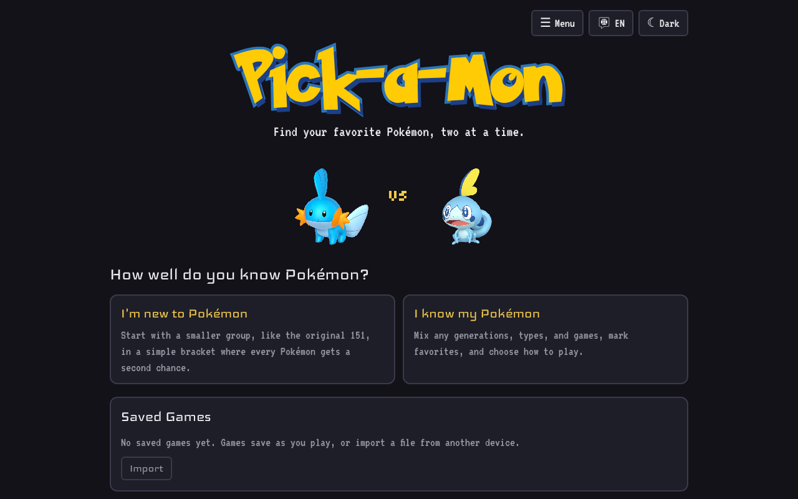

Pick-a-Mon shows you two Pokémon and asks which one you like more. Keep picking and it works out your favorite, a final team of six, a ranking of every Pokémon you played, and which games you could catch that team in. It runs entirely in the browser, works on phones, and is available in English, Japanese, Chinese, and French.

- [Features at a glance](#features-at-a-glance)
- [How it plays](#how-it-plays)
- [Tools](#tools)
- [Languages, saves, and controls](#languages-saves-and-controls)
- [Getting started](#getting-started) for developers

## Features at a glance

|                                                                         |                                                                           |
| ----------------------------------------------------------------------- | ------------------------------------------------------------------------- |
| 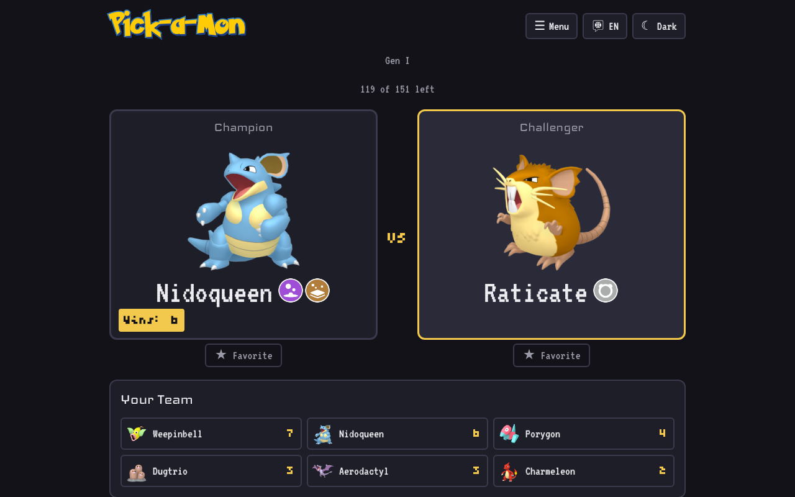 | 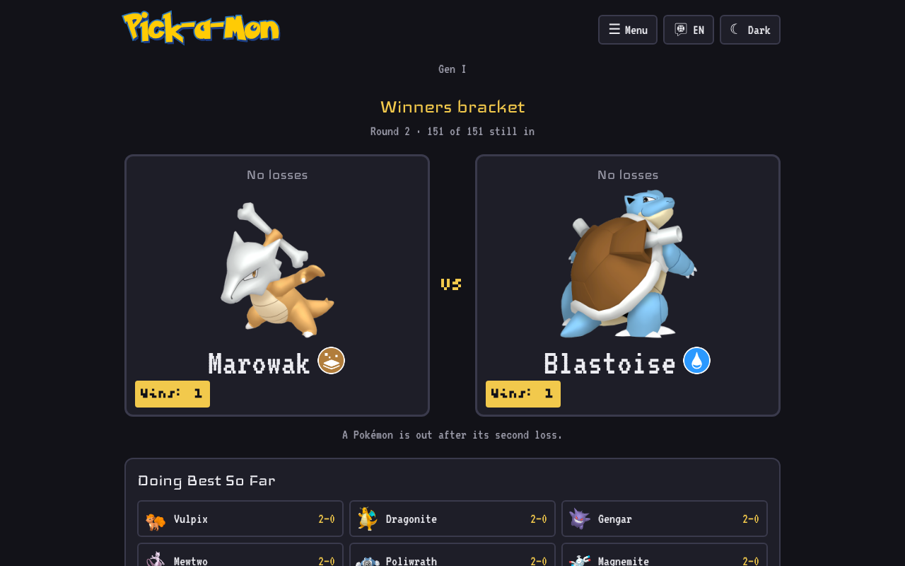  |
| **Classic**: king of the hill, with favorites and a Sudden Death final  | **Double elimination**: every Pokémon gets a second chance                |
| 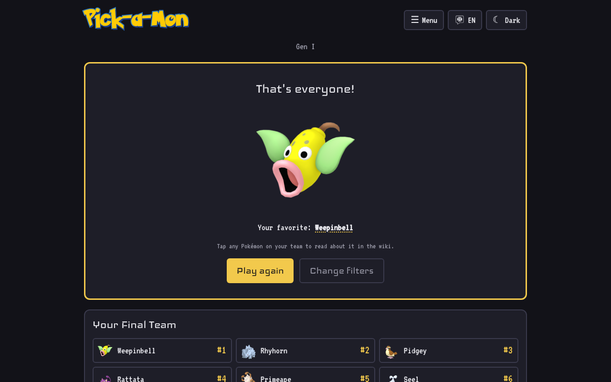                       | 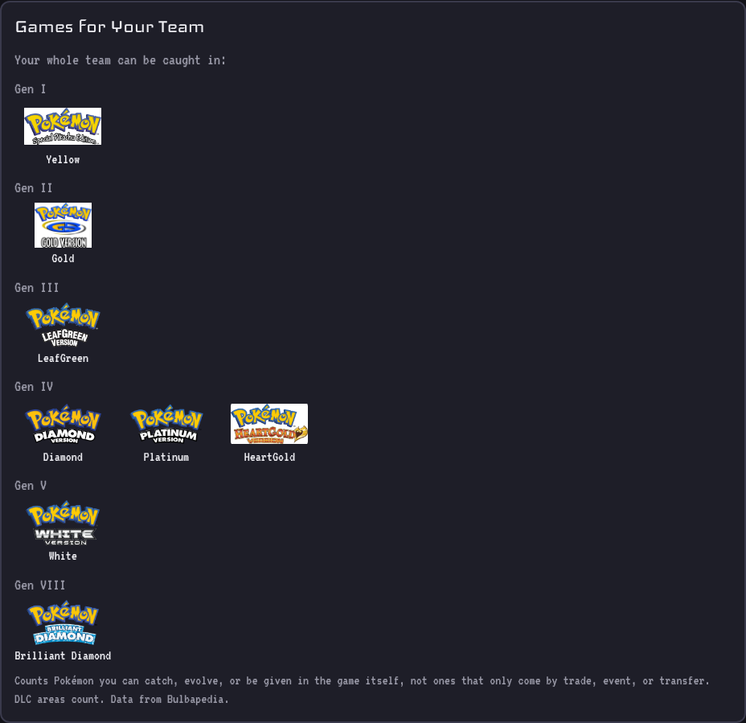     |
| **Your final team**, linked to each Pokémon's wiki page                 | **Games for your team**: every game you could build it in                 |
| 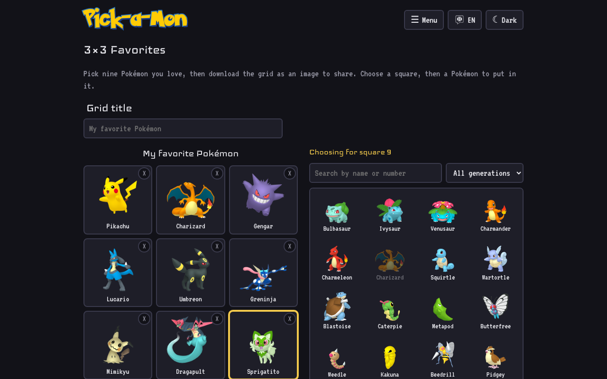                       | 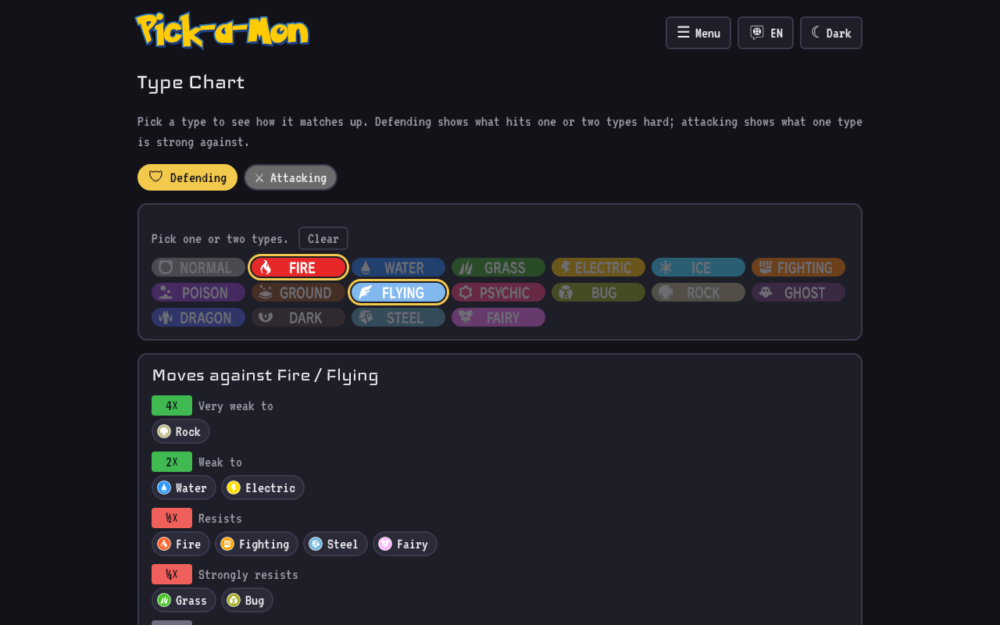                           |
| **3×3 Favorites**: make a shareable grid image                          | **Type chart**: weaknesses and resistances for any type pair              |

<p align="center">
  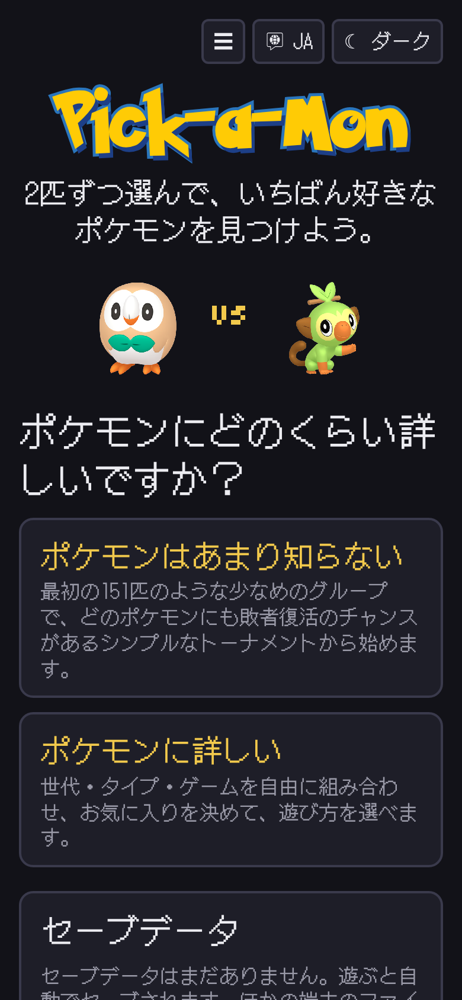
  &nbsp;&nbsp;
  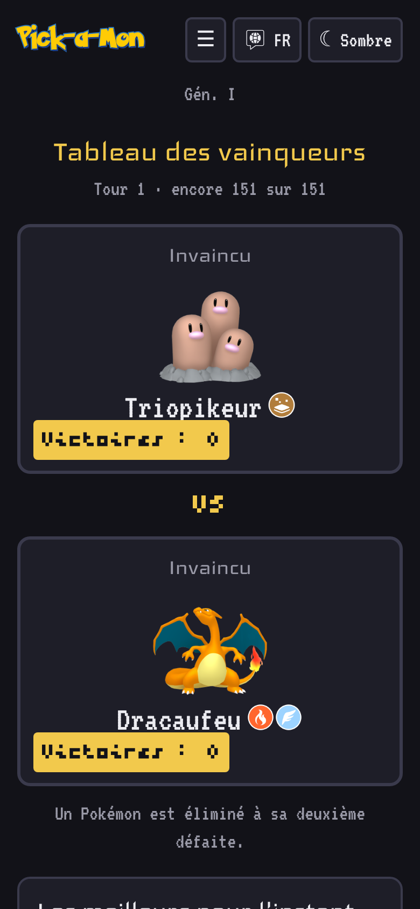
</p>
<p align="center"><em>On a phone, in Japanese and French.</em></p>

## How it plays

### Home screen

The site opens on the **Pick-a-Mon** title screen. **Continue** picks up the last game you played, if it isn't finished. Otherwise it asks how well you know Pokémon:

- **I'm new to Pokémon** opens the quick start: pick one generation (Gen I, the original 151, is marked as recommended; each tile shows that generation's starters and how many Pokémon it has) and play double elimination. It shows about how many picks that will take.
- **I know my Pokémon** opens the full setup: every filter, and a choice between the two modes.

**Saved Games** are listed on the home screen too. The **Pick-a-Mon** title in the header goes back to it from anywhere.

<p align="center">
  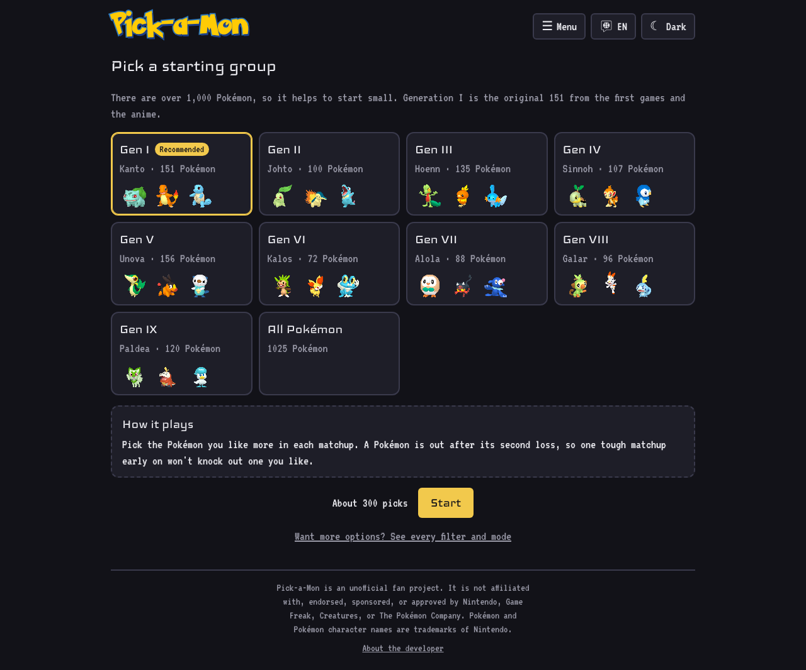
  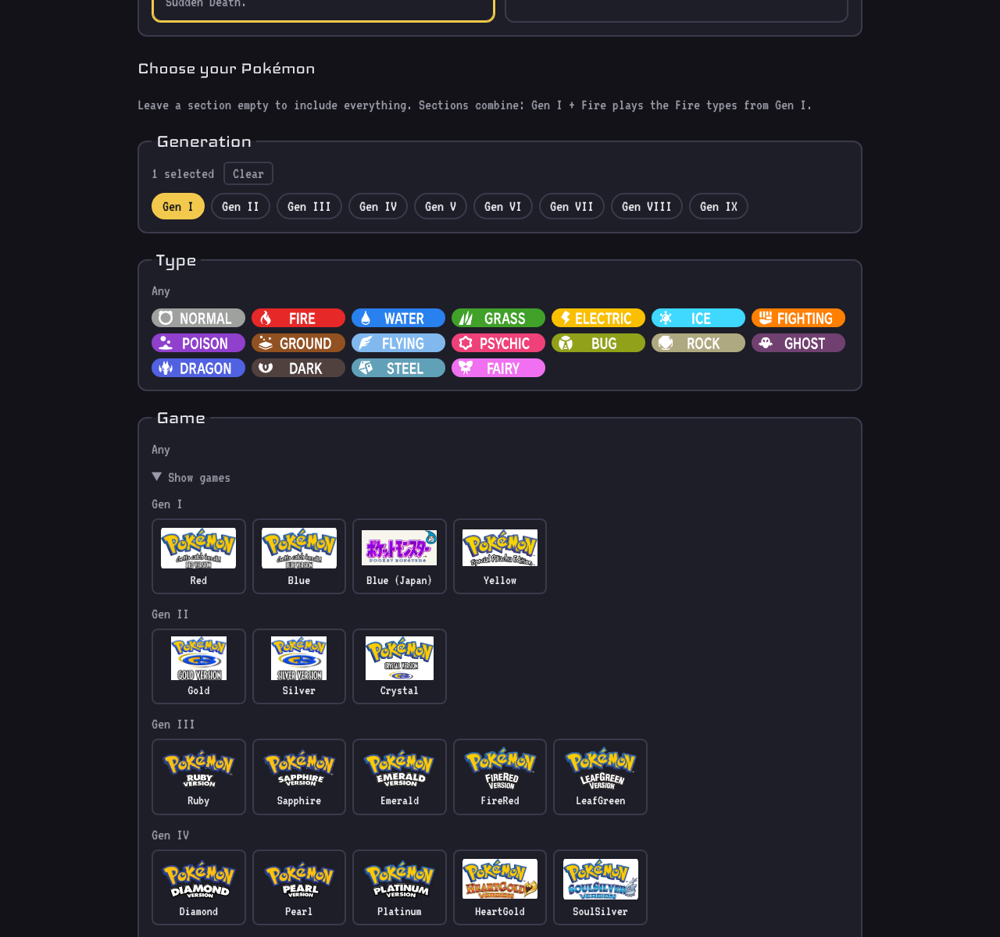
</p>

### Choosing your Pokémon

In the full setup, narrow the pool by **Generation**, **Type**, and **Game** (each game shows its cover art or logo). Leave a section empty to include everything. Within a section, a Pokémon only needs to match one of the selected options; across sections it must match all of them, so Gen I + Fire plays the Fire types from Gen I. The screen shows how many Pokémon match, and you need at least two to play. **Change filters** (during a game or at the end) goes back to the screen the game was set up on (quick start or full setup) with your last choices kept.

### Classic

**Main round**

- Every Pokémon in the pool appears exactly once, in a random order.
- The winner of each matchup stays on the left (on top on mobile) as the champion. The number in its bottom-left corner counts how many Pokémon it has beaten in a row.
- When a challenger wins, it becomes the new champion with 1 win.
- **★ Favorite** sends a Pokémon straight to Sudden Death and takes it out of the main round. Without this, a Pokémon you love would knock out every other Pokémon you like until it was beaten, so they would end up with few or no wins. Marked favorites are listed under **Favorites**; remove one with **×** to put it back into the draw.
- **Your Team** lists the six Pokémon with the longest win streaks, including the current champion.

**Sudden Death**

- Once every Pokémon has been shown, your favorites and the six longest win streaks from the main round face off.
- Each finalist is placed into a ranking by comparing it with Pokémon already ranked (a binary search), so you only make about *n* × log₂ *n* picks. Losing here only moves a Pokémon down the ranking; it is never knocked out.
- **Your Final Team** is the top six of that ranking.

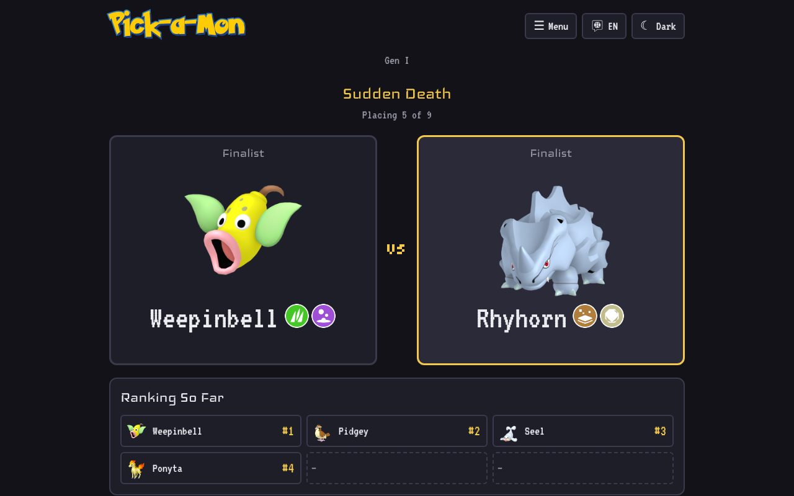

### Double elimination

A bracket where each Pokémon is out after its second loss. It needs no favorites, so it suits players who don't know the Pokémon well yet.

- Every Pokémon starts in the **winners bracket**. Its first loss moves it to the **second chance** bracket; its second loss knocks it out.
- Play goes in rounds. Each round pairs up the Pokémon waiting in each bracket at random (with an odd number, one sits the round out), winners-bracket matches first.
- When one Pokémon is left in each bracket they meet in the **final**. If the second-chance Pokémon wins, both have one loss, so a **final rematch** decides it.
- A pool of *n* Pokémon takes 2*n* − 2 picks (one more if the final goes to a rematch): about 300 for Gen I. When the pool is over 200, the setup screen suggests starting with Gen I and has a button to switch to it.
- Each card shows whether the Pokémon is still unbeaten or on its last chance, and its wins. **Doing Best So Far** lists the six still in with the fewest losses, then the most wins.
- **Your Final Team** is the champion, then the rest by how long they lasted (later rounds first, more wins breaking ties).

### When the game ends

- **Your Final Team** shows your top six. Each one links to its page in the [Pokémon wiki](#tools), and the browser's back button returns to the results.
- **Full ranking** lists every Pokémon in the game: in classic, the Sudden Death finalists in order, then everyone else by matchups won; in double elimination, by how long each one lasted. **Download CSV** saves it as `rank,dex_number,name,favorite,victories` (English headers, so files from different players and languages can be combined).
- **Games for Your Team** lists every main-series game your final team can be put together in, grouped by generation. Only Pokémon you can catch, evolve, or be given in that game count; ones that only arrive by trade, event, or transfer (Pokémon HOME, Poké Transfer, Pal Park) don't. DLC areas count toward their game. If no single game has the whole team, it lists paired versions that do when you trade between them (Sword + Shield, for example). If not even that works, it shows the games that come closest and which Pokémon each is missing.

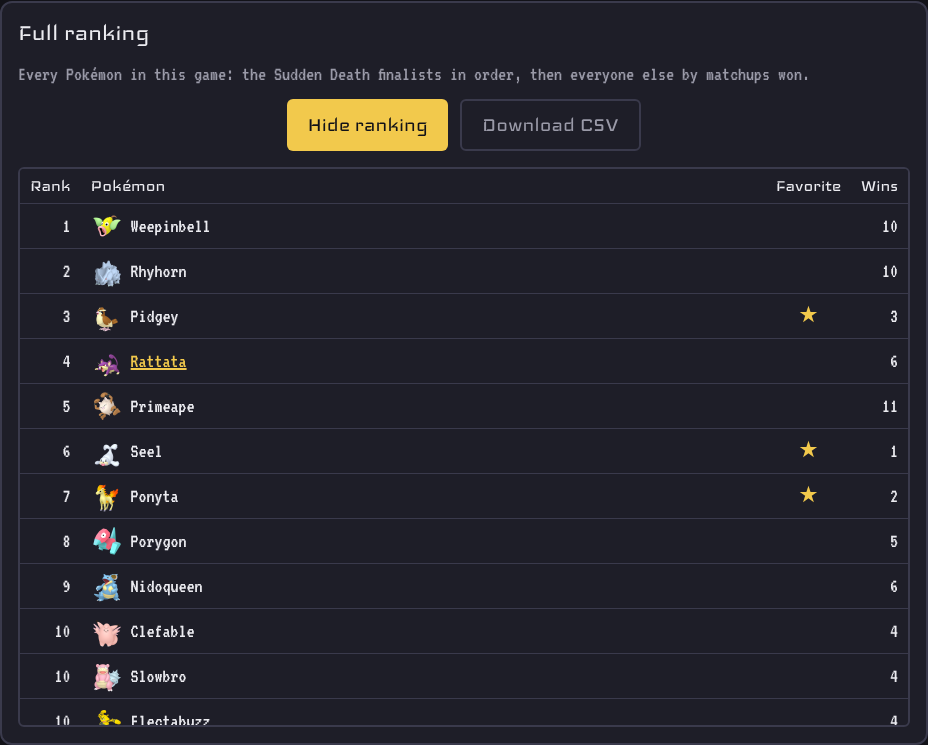

## Tools

The **Menu** in the header has a **Tools** section. Each tool has its own address, so it can be linked to directly.

- **3×3 Favorites** (`#3x3`): pick nine Pokémon, give the grid a title, and download it as an image (or share it, on browsers that can share files).
- **Type Chart** (`#types`): pick one or two defending types to see what they're weak to, resist, and are immune to, or one attacking type to see what it beats; the full 18 × 18 chart is below. `#types/Grass/Poison` opens it with those types picked.
- **Pokémon Wiki** (`#wiki`): search every Pokémon; each has a page (`#wiki/25`) with base stats (bars out of 255), types, profile, abilities, damage taken, evolution family, and the games it's in, shown with their art (games it only reaches by trade or transfer are faded). Types link to the type chart.

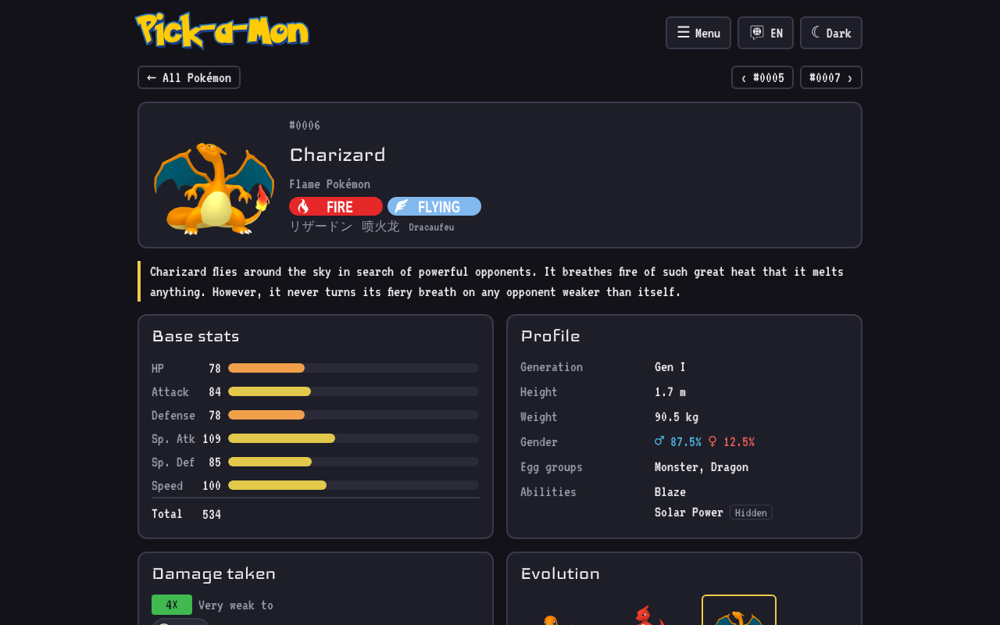

## Languages, saves, and controls

### Languages

The site is in English, Japanese, Chinese (Simplified), and French. On the first visit it uses the first of your browser's preferred languages that it has, without asking, and falls back to English. The language button (next to the theme toggle) switches it and remembers your choice. Pokémon names come from the data; type, game, and region names and the rest of the text are in `src/i18n/messages.js`. The type label cards are images with English text, so they stay in English, and species, Pokédex text, abilities, and evolution methods in the wiki are English only.

### Saved games

- Every pick is saved in your browser (`localStorage`), so closing the tab or reloading picks up right where you left off.
- You can keep several games going at once. **Saved Games** on the home screen lists each game with its mode, filters, progress, and when you last played it. **Continue** resumes one; **Delete** removes it. Starting a new game never overwrites an old one.
- Finished games stay in the list so you can look at your final team again.
- Saves stay in the browser they were made in. Up to 20 are kept; after that the least recently played is removed.
- To move games to another device or browser, use **Export** on a game (or **Export all**) to download a `.json` save file, then **Import** it on the other device. Importing never duplicates a game: if the same game is already there, the copy played more recently is kept.

### Controls

- Click or tap a card, or use the arrow keys (←/↑ for the left card, →/↓ for the right card).
- In classic mode, hold **Shift** with an arrow key to mark that Pokémon as a favorite.
- Dark mode is the default; the toggle in the header switches to light mode and remembers your choice.

## Status

- [x] Gather the Pokémon data and save it as a static file in the repo
- [x] Head-to-head matchups with sprites and type icons
- [x] Favorites and a Sudden Death round, so a top favorite can't block the Pokémon ranked just below it
- [x] Filter by generation, type, and game
- [x] Save game progress in the browser, with several saved games at once and export/import
- [x] Double-elimination mode for players who don't know the Pokémon well yet
- [x] Pick-a-Mon title screen, with a quick start for newcomers and the full setup for everyone else
- [x] Show which games you could build your final team in
- [x] Game art on the results, the game filter, and the wiki
- [x] A 3×3 grid of your favorite Pokémon
- [x] English, Japanese, Chinese, and French
- [x] A type chart and a Pokémon wiki, linked from the final team
- [x] A full ranking of every Pokémon in a finished game, with CSV download
- [ ] Pokémon from *Pokémon Winds and Waves* (2027)

## Getting started

Requires Node.js 22 or later.

```sh
npm install
npm run dev
```

Then open the local URL Vite prints (by default <http://localhost:5173/favorite-pokemon-head2head/>).

| Command           | What it does                                   |
| ----------------- | ---------------------------------------------- |
| `npm run dev`     | Start the dev server with hot reload           |
| `npm run build`   | Build the production site into `dist/`         |
| `npm run preview` | Serve the `dist/` build locally to check it    |
| `npm run lint`    | Lint the code with oxlint                      |

### Project layout

| Path                         | What it holds                                                        |
| ---------------------------- | -------------------------------------------------------------------- |
| `src/data/`                  | Pokémon JSON; `pokedex.js`, which normalizes it, attaches sprites, and builds the pool (`getPokemonPool(filters)`); `filters.js`, the generation, game, and type options; `teamGames.js`, which games a team fits in; `typeChart.js`; `gameArt.js` and `typeArt.js`, the artwork |
| `src/game/`                  | Pure game logic for each mode (`head2head.js`, `doubleElimination.js`, chosen in `modes.js`), the full ranking (`fullRanking.js`), and saved games in `localStorage` (`saves.js`) |
| `src/components/`            | UI components                                                        |
| `src/i18n/`                  | Languages, browser-language detection, every piece of site text per language (`messages.js`), and the `useI18n()` hook |
| `src/hooks/`                 | Dark/light theme state (`useTheme.js`) and the saved games list (`useSaves.js`) |
| `src/assets/images/sprites/` | One sprite per Pokémon, named by Pokédex number (`0001.png`)        |
| `src/assets/images/games/`   | Game cover art and logos (see below)                                 |
| `src/assets/fonts/`          | Self-hosted fonts: Iceland (headings), VT323 (text), Bytesized (accents), DotGothic16 (Japanese), ZCOOL KuaiLe (Chinese), with their licenses (OFL); Pokemon Solid for the title only |
| `tools/scraper.py`           | The Bulbapedia scraper that fills in generations, games, and sprites |
| `docs/screenshots/`          | The pictures in this README                                          |

### Updating the Pokémon data

The data in `src/data/pokemon_modified.json` comes from [Bulbapedia](https://bulbapedia.bulbagarden.net/) through `tools/scraper.py`, which fills in each Pokémon's generation, games, where it can be caught, and sprite, and adds any Pokémon that are missing. Fetched pages are cached in `tools/.bulbapedia_cache`, so re-runs are quick. Evolution data for new Pokémon has to be added by hand.

```sh
pip install requests beautifulsoup4 lxml
python tools/scraper.py --limit 5   # try it on the first 5 Pokémon
python tools/scraper.py             # full run
```

### Game art

Put a cover or logo for a game in `src/assets/images/games/`, named after the game's slug: lowercase, accents and apostrophes dropped, other punctuation and spaces turned into `-` (`sword.png`, `lets-go-pikachu.png`, `legends-arceus.png`, `blue-japan.png`). PNG, JPG, WebP, and SVG all work. It replaces the placeholder tile (the game's initials) everywhere the game appears on the next build; no code change is needed. Every main-series game has art. The DLC entries (`sword-expansion-pass`, `shield-expansion-pass`, `the-hidden-treasure-of-area-zero-scarlet`, `the-hidden-treasure-of-area-zero-violet`) and Colosseum, XD, Pokéwalker, and Dream World still use placeholders.

### Favicon

Put the icon at `public/favicon.png`. `index.html` already links to it (through Vite's `%BASE_URL%`, so it works under the GitHub Pages subpath), and Vite copies everything in `public/` into the build as is.

### Tech stack

- [React](https://react.dev/) + [Vite](https://vite.dev/) (JavaScript)
- [oxlint](https://oxc.rs/docs/guide/usage/linter) for linting
- Hosted on [GitHub Pages](https://pages.github.com/), built and deployed by GitHub Actions

Pokémon data is fetched ahead of time and committed as a static file, so the site needs no backend. Picks are saved in the visitor's browser.

### Deployment

Every push to `main` runs [`.github/workflows/deploy.yml`](.github/workflows/deploy.yml), which lints, builds, and publishes `dist/` to GitHub Pages. It can also be run by hand from the **Actions** tab.

One-time setup: in **Settings → Pages**, set **Source** to **GitHub Actions**.

Because the site is served from a subpath, `base` in `vite.config.js` is set to `/favorite-pokemon-head2head/`. If the repository is renamed or moved to a custom domain, update `base` to match.

## Credits and license

Pokémon data, game availability, and sprites come from [Bulbapedia](https://bulbapedia.bulbagarden.net/). Fonts are self-hosted under their own licenses in `src/assets/fonts/`.

The code is under the license in [LICENSE](LICENSE).

Pokémon and Pokémon character names are trademarks of Nintendo, Creatures Inc., and GAME FREAK inc. This is an unofficial fan project and is not affiliated with or endorsed by them.
